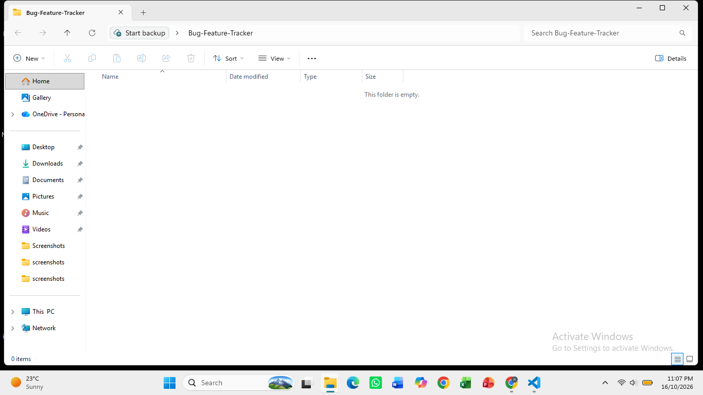
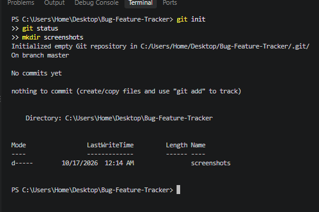
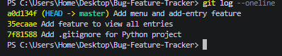
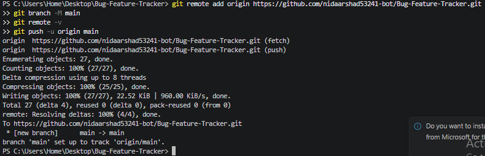
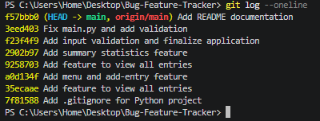

# Bug & Feature Tracker

## Project Description
Bug & Feature Tracker is a simple Python terminal application that lets users record software bugs and feature requests, view them, and see a summary of the tracker. The main goal of this project is to practice the Git and GitHub command-line workflow.

## Features
- Add a new entry (title, type: Bug/Feature, priority: Low/Medium/High, status: Open/Resolved)
- View all entries in a readable format
- Summary statistics: total entries, bugs, feature requests, open and resolved entries
- Simple menu for navigation
- Input validation: empty titles and invalid menu choices do not crash the program

## Technologies Used
- Python 3
- Git
- GitHub

## How to Run
```bash
python main.py
```

## Git Workflow
1. Created an empty local folder named `Bug-Feature-Tracker`.
2. Created an empty repository on GitHub (without README, .gitignore or license).
3. Ran `git init` to initialize the local repository.
4. Built the app step by step, using `git add .` and `git commit -m "..."` after each feature.
5. Connected the local repo to GitHub with `git remote add origin <URL>`.
6. Ran `git branch -M main` and `git push -u origin main` to push the project.
7. Verified the history with `git log --oneline`.

## Development History
1. Added `.gitignore` for the Python project.
2. Added the menu and add-entry feature.
3. Added the feature to view all entries.
4. Added summary statistics.
5. Added input validation and finalized the application.
6. Added README documentation.
7. Added screenshot evidence.

## Screenshots

### Initial Empty Folder


### Git Initialization


### Commits


### Successful Push


### Commit History


## Author
Nida